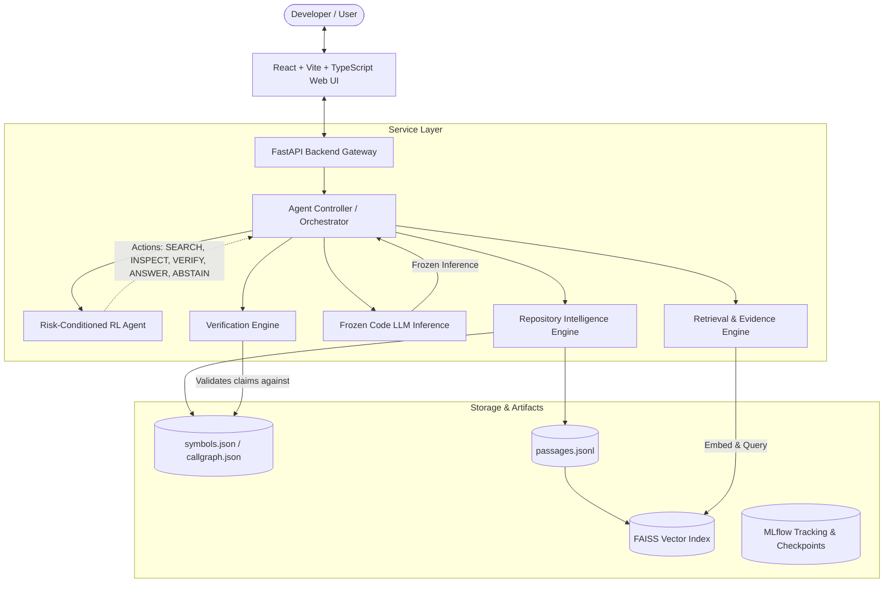

# RepoGuard

> **Making AI coding assistants more reliable** — RepoGuard combines code intelligence, evidence-based verification, and reinforcement learning to deliver trustworthy, repository-grounded answers.

[](https://www.python.org/)
[](LICENSE)
[](#testing)

---

## Table of Contents

- [Problem Statement](#problem-statement)
- [The RepoGuard Solution](#the-repoguard-solution)
- [System Architecture](#system-architecture)
- [Module Overview](#module-overview)
- [Phase 1 — Baseline Results](#phase-1--baseline-results)
- [Phase 2 — RL Agent (Roadmap)](#phase-2--rl-agent-roadmap)
- [Repository Structure](#repository-structure)
- [Installation & Setup](#installation--setup)
- [Usage](#usage)
- [Configuration Reference](#configuration-reference)
- [Testing](#testing)
- [Benchmark Repositories](#benchmark-repositories)
- [Contributing](#contributing)
- [License](#license)

---

## Problem Statement

Large Language Models (LLMs) have demonstrated substantial utility in software engineering. However, when deployed to answer queries over complex software repositories, they suffer from critical failure modes:

1. **Hallucination of Code Entities** — Fabricating functions, classes, arguments, and module paths that do not exist.
2. **Unsupported Architectural Claims** — Asserting dependency relationships or call graphs that contradict the codebase.
3. **Over-Computation & Token Waste** — Executing multiple unguided search and generation cycles even when the target information is unreachable.
4. **Failure to Abstain** — Generating plausible-sounding yet erroneous answers rather than explicitly declining when evidence is lacking.

---

## The RepoGuard Solution

RepoGuard implements a **four-tiered architecture** designed to ensure verifiable repository grounding:

```
[User Query]
     │
     ▼
[Risk-Conditioned RL Agent] ── Learns step-by-step policy: SEARCH, INSPECT, VERIFY, ANSWER, ABSTAIN
     │
     ├──► [Repository Intelligence] ── Static AST, Symbol Table, Call Graph, FAISS Passages
     ├──► [Frozen Code LLM]         ── Generates grounded candidate answers with claim tags
     └──► [Verification Engine]     ── Fact-checks code claims against ground-truth AST
     │
     ▼
[Verified Response or Principled Abstention]
```

### Core Principles

| Principle | Description |
|:---|:---|
| **Evidence-First** | Every answer must be linked to verifiable code snippets and line ranges. |
| **Structural Ground Truth** | Natural language is ambiguous, but ASTs are deterministic. Verification evaluates structural code entities, not fuzzy semantics. |
| **Learned Risk Sensitivity** | An RL agent learns *when* to answer and *when* to abstain based on user risk tolerance and verification feedback. |
| **Hardware Pragmatism** | Designed to run on realistic hardware (e.g., 6 GB VRAM RTX 3050) by freezing the LLM and training only the decision policy. |

---

## System Architecture



---

## Module Overview

### 1. Repository Intelligence Engine — `src/repoguard/repository/`

Responsible for parsing Python repositories into structured, queryable metadata.

| Component | Purpose |
|:---|:---|
| `parser.py` | Safe recursive AST scanning — extracts functions, classes, imports, arguments, return types, docstrings, and line spans with path traversal guards. |
| `callgraph.py` | Resolves intra-repository function calls to construct a directed static call graph (caller → callee edges). |
| `passage_builder.py` | Partitions source into semantically bounded code passages tagged with file paths and line ranges. |
| `indexer.py` | Orchestrates parsing, call graph construction, and passage generation. Outputs `symbols.json`, `callgraph.json`, and `passages.jsonl`. |

### 2. Retrieval & Evidence Engine — `src/repoguard/retrieval/`

| Component | Purpose |
|:---|:---|
| `embedder.py` | Embedding interface (`BaseEmbedder`) with `SentenceTransformerEmbedder` (default: `all-MiniLM-L6-v2`) and `MockEmbedder` for deterministic CPU testing. |
| `search.py` | Builds and queries FAISS vector indexes (`IndexFlatIP` / `IndexHNSWFlat`). Maps top-K matches to structured `Evidence` objects with file path, line numbers, snippet content, and similarity scores. |

### 3. Verification Engine — `src/repoguard/verification/`

Deterministic fact-checking of LLM claims against repository ground truth. Evaluates six claim types:

- `FILE_EXISTS` · `FUNCTION_EXISTS` · `CLASS_EXISTS` · `PARAMETER_EXISTS` · `CALLS` · `IMPORTS`

Each claim receives a verdict: **VERIFIED**, **REFUTED**, or **UNVERIFIABLE**. The engine strictly evaluates structural code facts — it does *not* attempt open-ended natural language semantics.

### 4. Frozen Code LLM Inference — `src/repoguard/llm.py`

- Loads HuggingFace Transformers models (default: `Qwen/Qwen2.5-Coder-3B-Instruct`).
- Supports 4-bit NF4 quantization via `bitsandbytes` for 6 GB VRAM GPUs.
- Provides `MockLLM` for fast, deterministic CPU testing.
- Captures token usage, response latency, and finish reasons.

### 5. Risk-Conditioned RL Agent — `src/repoguard/agent/`

| Component | Purpose |
|:---|:---|
| `actions.py` | Discrete action space: `SEARCH` · `INSPECT` · `VERIFY` · `ANSWER` · `ANSWER_WITH_EVIDENCE` · `ABSTAIN`. |
| `state.py` | 18-dimensional continuous state vector incorporating query complexity, retrieval similarity, verification ratios, model uncertainty, risk tolerance, step/token budgets, and action-history flags. |
| `reward.py` | Multi-objective reward: verified answer (+1.0), correct abstention (+0.6), hallucination penalty (−2.0), step cost (−0.05/step), token cost (−0.0008/token). |
| `environment.py` | Gymnasium-compatible `RepoGuardEnv` wrapping index, retriever, LLM, and verifier. |
| `policy.py` | PyTorch DQN with replay buffer, epsilon-greedy exploration, and `RuleBasedBaselineController` for benchmark comparison. |
| `controller.py` | High-level orchestrator that executes a full episode for a user query. |

### 6. Evaluation & Benchmarks — `src/repoguard/evaluation/`

Computes: Recall@K · MRR · Verification Precision · Hallucination Rate · Abstention Accuracy · Token Efficiency.

### 7. API & Frontend — `src/repoguard/api/` & `frontend/`

- **FastAPI Backend**: `/health`, `/repositories`, `/repositories/{id}/status`, `/query` (end-to-end Q&A with evidence, verification verdicts, action traces, risk metrics, and token/latency breakdown).
- **Vite + React + TypeScript Frontend**: Developer dashboard, interactive query console with risk-tolerance slider, verification badge breakdown, agent action timeline, and raw evidence viewer.

---

## Phase 1 — Baseline Results

Phase 1 established the frozen LLM inference pipeline and ran a **100-question benchmark** (50 answerable + 50 adversarial hallucination traps) across three baseline strategies using `Qwen/Qwen2.5-Coder-3B-Instruct` (NF4 4-bit quantized) on the [`dbader/schedule`](https://github.com/dbader/schedule) repository.

### Hardware

- **GPU**: NVIDIA RTX 3050 Laptop (6 GB VRAM)
- **Model Footprint**: ~2,150 MB static, ~2,810 MB peak during generation
- **VRAM Optimization**: `torch.cuda.empty_cache()` after every generation, `max_new_tokens=128`, 20-question balanced shards

### Results

| Metric | Baseline 1: `always_answer` | Baseline 2: `always_evidence` | Baseline 3: `threshold_gate` |
|:---|:---:|:---:|:---:|
| **Strategy** | Zero-shot (no retrieval) | Standard dense RAG (top-3) | RAG + static similarity gate (< 0.45 → abstain) |
| **Coverage** | 100.0% | 100.0% | 13.0% |
| **Hallucination Rate** | 50.0% | 50.0% | 0.0% |
| **Accuracy on Answered** | 50.0% | 50.0% | 100.0% |
| **Correct Abstention** | 0.0% | 0.0% | 100.0% |
| **Over-refusal Rate** | 0.0% | 0.0% | 74.0% |
| **Mean Tokens / Query** | 181.8 | 586.0 | 67.8 |
| **Median Latency** | 8,109 ms | 8,228 ms | 5 ms |

### Key Takeaways

1. **Zero-shot LLMs** confidently fabricate non-existent code entities → 50% hallucination rate.
2. **Standard RAG** inflates token usage by 3.2× without reducing hallucinations on adversarial traps — partial evidence *induces* hallucination.
3. **Static similarity gating** eliminates hallucinations but collapses coverage to 13% due to a 74% over-refusal rate.

> **Conclusion**: Neither static generation, naive RAG, nor rigid confidence gating can satisfy the dual requirements of *high coverage* and *low hallucination*. This provides the definitive scientific justification for **Phase 2: a learned RL policy** that dynamically balances retrieval depth, verification rigor, and abstention risk.

---

## Phase 2 — RL Agent (Roadmap)

| Milestone | Description | Status |
|:---|:---|:---:|
| `RepoGuardEnv` implementation | Gymnasium-compatible environment with discrete action space | 🔲 Planned |
| 18-dim state vector | Query intent, retrieval similarity, AST verification, step/token budgets | 🔲 Planned |
| DQN training loop | Replay buffer, target network, epsilon-greedy exploration | 🔲 Planned |
| Multi-objective reward tuning | Calibrate abstention reward vs. hallucination penalty | 🔲 Planned |
| Comparative evaluation | RL Agent vs. Rule-Based Baseline vs. Baselines 1–3 | 🔲 Planned |
| MLflow experiment tracking | Reward curves, Q-value loss, epsilon decay, per-epoch metrics | 🔲 Planned |

---

## Repository Structure

```
Repo-Guard/
├── configs/                        # Experiment configuration files
│   ├── config.yaml                 # App-level settings (host, port, mock mode)
│   ├── model_config.yaml           # LLM model parameters (Qwen2.5, 4-bit, temp=0.1)
│   ├── retrieval_config.yaml       # Embedding model, FAISS settings, top-K
│   ├── rl_config.yaml              # DQN hyperparameters, reward weights
│   └── repos.yaml                  # Pinned benchmark repository snapshots
│
├── data/
│   ├── baseline/                   # Raw inference outputs (JSONL traces)
│   ├── questions/                  # Benchmark question sets
│   │   └── baseline_questions.jsonl  # 100 questions (50 answerable + 50 traps)
│   ├── indexes/                    # Generated FAISS indexes & symbol tables
│   ├── repos/                      # Cloned target repositories
│   ├── experiments/                # MLflow experiment artifacts
│   ├── processed/                  # Processed data files
│   └── raw/                        # Raw data files
│
├── docs/                           # Project documentation
│   ├── project_overview.md         # Problem statement & solution overview
│   ├── architecture.md             # Full architecture specification
│   ├── research_methodology.md     # Hypothesis, baselines, evaluation metrics
│   ├── data_schema.md              # Pydantic models & data contracts
│   ├── development_setup.md        # Developer onboarding guide
│   ├── deployment_guide.md         # Docker & cloud deployment
│   ├── api_documentation.md        # API endpoint reference
│   ├── index_schema.md             # Index file format specification
│   └── team_responsibilities.md    # Team role assignments
│
├── reports/                        # Generated evaluation reports
│   ├── baseline_results.csv        # Phase 1 metrics summary
│   ├── phase1_baseline_report.md   # Detailed Phase 1 analysis
│   └── index_validation/           # Per-repository index validation reports
│
├── scripts/                        # CLI entry-points
│   ├── run_baseline.py             # Run baseline inference
│   ├── evaluate_baseline.py        # Compute evaluation metrics
│   ├── build_index.py              # Build repository index
│   ├── fetch_repos.py              # Clone pinned repositories
│   ├── generate_questions.py       # Generate benchmark questions
│   ├── search_index.py             # Interactive index search
│   └── validate_index.py           # Validate index integrity
│
├── src/repoguard/                  # Core library
│   ├── repository/                 # AST parser, call graph, passage builder, indexer
│   ├── retrieval/                  # Embedder, FAISS search
│   ├── verification/               # Claim extractor, structural verifier
│   ├── agent/                      # RL environment, policy, reward, state, controller
│   ├── evaluation/                 # Metrics computation, batch evaluator
│   ├── api/                        # FastAPI routes
│   ├── llm.py                      # Frozen LLM inference engine
│   ├── baselines.py                # Baseline strategy implementations
│   ├── config.py                   # Configuration loader
│   ├── schemas.py                  # Shared Pydantic data models
│   ├── exceptions.py               # Custom exception hierarchy
│   └── logging_config.py           # Structured logging setup
│
├── tests/                          # Test suite
│   ├── unit/                       # Unit tests (parser, indexer, callgraph, retrieval)
│   ├── integration/                # Integration tests
│   ├── fixtures/                   # Test fixtures (sample repos)
│   ├── test_llm.py                 # LLM inference tests
│   └── conftest.py                 # Shared pytest fixtures
│
├── frontend/                       # React + Vite + TypeScript web UI
├── deployment/docker/              # Docker configuration
├── experiments/                    # Experiment configs & results
│
├── .env.example                    # Environment variable template
├── pyproject.toml                  # Build config, dependencies, linting rules
├── setup.py                        # Setuptools entry-point
├── Makefile                        # Common dev commands
├── CONTRIBUTING.md                 # Contribution guidelines & branch strategy
├── CODE_OF_CONDUCT.md              # Code of conduct
├── LICENSE                         # Apache License 2.0
└── README.md                       # This file
```

---

## Installation & Setup

### Prerequisites

- **Python** 3.10 or 3.11
- **Node.js** 18+ (for frontend)
- **Git**
- **Hardware**: Works on CPU-only machines (mock mode). GPU recommended for live inference (NVIDIA with ≥ 6 GB VRAM).

### Quickstart

```bash
# 1. Clone the repository
git clone https://github.com/<your-org>/Repo-Guard.git
cd Repo-Guard

# 2. Create and activate a virtual environment
python -m venv .venv
# Windows (PowerShell):
.venv\Scripts\Activate.ps1
# Linux/macOS:
source .venv/bin/activate

# 3. Copy environment config
cp .env.example .env

# 4. Install dependencies
pip install -e ".[dev]"          # Core + dev/test tools

# Optional: Install ML libraries (PyTorch, Transformers, FAISS)
pip install -e ".[ml]"           # Required only for live neural inference

# Install everything:
pip install -e ".[all]"
```

### Mock Mode vs Live ML Mode

Set in `.env`:

| Mode | `MOCK_MODE` | Description |
|:---|:---:|:---|
| **Mock** (default) | `true` | Fast, deterministic mock LLM/embedder/FAISS. No GPU or model downloads needed. Perfect for development, testing, and CI. |
| **Live** | `false` | Loads real `Qwen2.5-Coder-3B-Instruct` and `all-MiniLM-L6-v2`. Requires PyTorch + compatible GPU. |

---

## Usage

### Fetch & Index a Repository

```bash
# Clone pinned benchmark repositories
python scripts/fetch_repos.py schedule

# Build the repository index (symbols, call graph, passages)
python scripts/build_index.py --repo schedule
```

### Run Baseline Inference

```bash
# Full 100-question benchmark (runs in 20-question shards)
python scripts/run_baseline.py \
    --config configs/model_config.yaml \
    --questions data/questions/baseline_questions.jsonl \
    --output data/baseline/raw_outputs.jsonl

# Single shard (0-based index; shard 2 = questions 41-60)
python scripts/run_baseline.py --batch-index 2
```

### Evaluate Results

```bash
python scripts/evaluate_baseline.py
# Outputs: reports/baseline_results.csv
```

### Run the Backend API

```bash
uvicorn repoguard.api.main:app --host 0.0.0.0 --port 8000 --reload
# Interactive docs: http://localhost:8000/docs
# Health check:     http://localhost:8000/health
```

### Run the Frontend

```bash
cd frontend
npm install
npm run dev
# Open http://localhost:5173
```

---

## Configuration Reference

| File | Purpose | Key Parameters |
|:---|:---|:---|
| `configs/config.yaml` | App settings | `host`, `port`, `mock_mode`, `cors_origins` |
| `configs/model_config.yaml` | LLM inference | `model: Qwen/Qwen2.5-Coder-3B-Instruct`, `quantization_bits: 4`, `max_new_tokens: 128`, `temperature: 0.1` |
| `configs/retrieval_config.yaml` | Embedding & search | `embedding_model: all-MiniLM-L6-v2`, `top_k: 5`, `similarity_threshold: 0.35` |
| `configs/rl_config.yaml` | RL training | `algorithm: DQN`, `state_dim: 18`, `action_dim: 6`, `gamma: 0.99`, `lr: 0.0005` |
| `configs/repos.yaml` | Benchmark repos | Pinned commits for `schedule`, `python-dotenv`, `cachetools`, `python-tabulate`, `requests` |
| `.env` / `.env.example` | Environment variables | All of the above plus `MLFLOW_TRACKING_URI`, `VITE_API_BASE_URL` |

---

## Testing

```bash
pytest
```

All tests pass in mock mode without GPU or model downloads:

```
89 passed, 2 skipped
```

Test coverage includes:
- **AST Parser** — function/class/import extraction across nested packages
- **Call Graph** — intra-module and cross-module caller-callee resolution
- **Indexer** — end-to-end index generation and manifest validation
- **Retrieval** — embedding, FAISS index build/query, evidence mapping
- **LLM Inference** — model loading, prompt building, token counting, mock/live modes

---

## Benchmark Repositories

| Repository | License | Role | Commit |
|:---|:---|:---|:---|
| [`dbader/schedule`](https://github.com/dbader/schedule) | MIT | Primary (Phase 1 development & baseline) | `82a43db` |
| [`theskumar/python-dotenv`](https://github.com/theskumar/python-dotenv) | BSD-3-Clause | Training | `4fbc6ff` |
| [`tkem/cachetools`](https://github.com/tkem/cachetools) | MIT | Training | `c5de513` |
| [`astanin/python-tabulate`](https://github.com/astanin/python-tabulate) | MIT | Training | `268615a` |
| [`psf/requests`](https://github.com/psf/requests) | Apache-2.0 | Held-out (generalization test only) | `3c7baaa` |

---

## Contributing

See [CONTRIBUTING.md](CONTRIBUTING.md) for the full guide. Summary:

1. **Fork** the repo and create a feature branch (`feature/your-topic`).
2. Follow existing code style — enforced by `ruff` (config in `pyproject.toml`).
3. Write or update tests for any new behaviour.
4. Ensure `pytest` and `ruff check src/ tests/` pass before opening a PR.
5. **Do not modify `src/repoguard/schemas.py`** without team consensus (see [Golden Rule](CONTRIBUTING.md#3-the-golden-rule-shared-interface-immutability)).

### Branch Strategy

| Branch | Purpose |
|:---|:---|
| `main` | Protected, stable, passes CI |
| `llm` | Member 3 — Frozen LLM inference, RL environment, baselines |
| `feature/indexer` | Member 1 — Repository intelligence & retrieval |
| `feature/verifier` | Member 2 — Structural verification & claim extraction |

---

## License

This project is licensed under the **Apache License 2.0** — see the [LICENSE](LICENSE) file for details.

---

<sub>Last updated: November 22, 2026</sub>
