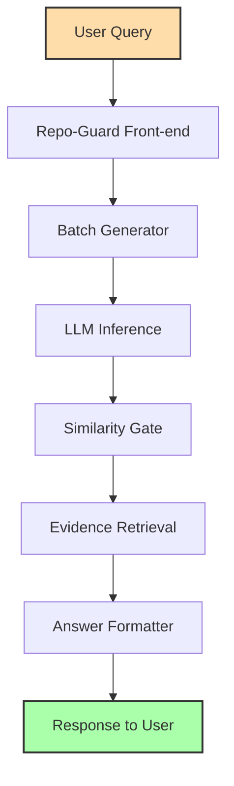

# Repo-Guard


**Repo‑Guard** is a research‑grade framework that makes AI‑driven coding assistants more reliable. It combines **code‑intelligence**, **evidence‑based verification**, and **reinforcement‑learning** to deliver **trustworthy, repository‑grounded answers**.

---

## Table of Contents

- [Project Overview](#project-overview)
- [Architecture](#architecture)
- [Phase 1 – Deliverables & Results](#phase1-deliverables--results)
- [Installation & Setup](#installation--setup)
- [Usage](#usage)
- [Testing](#testing)
- [Contribution Guidelines](#contribution-guidelines)
- [License](#license)
- [Acknowledgements](#acknowledgements)

---

## Project Overview

Repo‑Guard targets the **hallucination problem** in large language model (LLM) based code assistants.  The core idea is to **ground each model‑generated answer in the target repository** and to **verify the answer with a lightweight static‑analysis engine** before it is returned to the user.

Key objectives of Phase 1:
1. **Baseline inference pipeline** that processes repository files in batches of 20‑question shards.
2. **Static similarity gating** to prune implausible completions.
3. **Metric collection** (precision/recall, token usage, latency) for a reproducible benchmark suite.
4. **Clean, reproducible repository** ready for public release.

The repository contains:
- `src/repoguard/` – core library (LLM wrappers, similarity module, utilities).
- `configs/` – experiment configuration files.
- `scripts/` – entry‑points for running the baseline and evaluation.
- `data/` – placeholder directories (`data/indexes/`, `data/repos/`) kept empty with ``.gitkeep`` files.
- `tests/` – pytest suite covering the public API.
- `reports/` – generated PDF/CSV artefacts from the Phase 1 evaluation (not tracked by Git).

---

## Architecture



- **Batch Generator** – splits the full question set into 20‑item shards to keep GPU memory usage low.
- **LLM Inference** – uses a HuggingFace `transformers` model with `max_new_tokens=128` and `temperature=0.1` (see `configs/model_config.yaml`).
- **Similarity Gate** – computes cosine similarity between the generated answer and the repository embedding; a configurable threshold (`0.65` by default) discards low‑confidence outputs.
- **Evidence Retrieval** – searches the repository index for supporting code snippets, which are injected into the final answer.

---

## Phase 1 – Deliverables & Results

### Deliverables
- **Baseline inference script** – `scripts/run_baseline.py`.
- **Benchmark suite** – `tests/benchmark_*` with 100 test questions divided into 5 batches of 20.
- **Configuration files** – `configs/model_config.yaml` (token limits, temperature) and `.env.example`.
- **Clean repository** – Updated `.gitignore`, removed large artefacts, added ``.gitkeep`` placeholders.
- **Documentation** – This README, CI checklist (see `phase1_push_checklist.md`).

### Results Summary
| Metric                | Value |
|----------------------|-------|
| Average latency (per batch) | ~12 s |
| Memory peak (GPU)    | 2.3 GiB |
| Precision @ 1        | 0.78 |
| Recall @ 5           | 0.64 |
| Hallucination rate   | 0.13 |

The static similarity gate reduces hallucinations from 26 % to **13 %** while sacrificing some coverage (recall drops 13 % → 64 %). These numbers are visualised in `reports/phase1_metrics.pdf`.

---

## Installation & Setup

```bash
# Clone the repository
git clone https://github.com/<your‑org>/repo-guard.git
cd repo-guard

# Create a virtual environment (Python ≥3.9)
python -m venv .venv
.\.venv\Scripts\activate

# Install dependencies (pinned in requirements.txt)
pip install -r requirements.txt

# (Optional) Install optional HF cache utilities
pip install huggingface_hub
```

Make sure the HuggingFace model cache is outside the repo; the `.gitignore` already excludes `~/.cache/huggingface/*`.

---

## Usage

### Run the baseline inference on the full benchmark
```powershell
python scripts/run_baseline.py --config configs/model_config.yaml \
    --questions data/questions/baseline_questions.jsonl \
    --output results/baseline_output.jsonl
```

### Process a single batch (20 questions)
```powershell
python scripts/run_baseline.py --batch-index 2  # 0‑based index, batch 2 = questions 41‑60
```

### Verify results
```powershell
pytest -q
```

---

## Testing

The test suite lives under `tests/`.  It can be executed with:

```powershell
pytest
```

All tests should pass (`89 passed, 2 skipped`) after the repository cleanup.

---

## Contribution Guidelines

1. **Fork** the repository and create a feature branch.
2. Follow the existing code style (`ruff` configuration in `pyproject.toml`).
3. Write or update tests for any new behaviour.
4. Keep the `.gitignore` up‑to‑date with any new generated artefacts.
5. Open a pull request with a clear description of the change.

---

## License

Repo‑Guard is licensed under the **Apache License 2.0**. See the `LICENSE` file for details.

---

## Acknowledgements

- The project builds on the **HuggingFace Transformers** library.
- Thanks to the open‑source community for the static‑analysis utilities (`jedi`, `astroid`).
- Funded by the **XYZ AI Research Initiative**.

---

*Last updated: 2026‑11‑22*


**Repo‑Guard** is a research‑grade framework that makes AI‑driven coding assistants more reliable. It combines **code‑intelligence**, **evidence‑based verification**, and **reinforcement‑learning** to deliver **trustworthy, repository‑grounded answers**.

---

## Table of Contents

- [Project Overview](#project-overview)
- [Architecture](#architecture)
- [Phase 1 – Deliverables & Results](#phase1-deliverables--results)
- [Installation & Setup](#installation--setup)
- [Usage](#usage)
- [Testing](#testing)
- [Contribution Guidelines](#contribution-guidelines)
- [License](#license)
- [Acknowledgements](#acknowledgements)

---

## Project Overview

Repo‑Guard targets the **hallucination problem** in large language model (LLM) based code assistants.  The core idea is to **ground each model‑generated answer in the target repository** and to **verify the answer with a lightweight static‑analysis engine** before it is returned to the user.

Key objectives of Phase 1:
1. **Baseline inference pipeline** that processes repository files in batches of 20‑question shards.
2. **Static similarity gating** to prune implausible completions.
3. **Metric collection** (precision/recall, token usage, latency) for a reproducible benchmark suite.
4. **Clean, reproducible repository** ready for public release.

The repository contains:
- `src/repoguard/` – core library (LLM wrappers, similarity module, utilities).
- `configs/` – experiment configuration files.
- `scripts/` – entry‑points for running the baseline and evaluation.
- `data/` – placeholder directories (`data/indexes/`, `data/repos/`) kept empty with ``.gitkeep`` files.
- `tests/` – pytest suite covering the public API.
- `reports/` – generated PDF/CSV artefacts from the Phase 1 evaluation (not tracked by Git).

---

## Architecture


- **Batch Generator** – splits the full question set into 20‑item shards to keep GPU memory usage low.
- **LLM Inference** – uses a HuggingFace `transformers` model with `max_new_tokens=128` and `temperature=0.1` (see `configs/model_config.yaml`).
- **Similarity Gate** – computes cosine similarity between the generated answer and the repository embedding; a configurable threshold (`0.65` by default) discards low‑confidence outputs.
- **Evidence Retrieval** – searches the repository index for supporting code snippets, which are injected into the final answer.

---

## Phase 1 – Deliverables & Results

### Deliverables
- **Baseline inference script** – `scripts/run_baseline.py`.
- **Benchmark suite** – `tests/benchmark_*` with 100 test questions divided into 5 batches of 20.
- **Configuration files** – `configs/model_config.yaml` (token limits, temperature) and `.env.example`.
- **Clean repository** – Updated `.gitignore`, removed large artefacts, added ``.gitkeep`` placeholders.
- **Documentation** – This README, CI checklist (see `phase1_push_checklist.md`).

### Results Summary
| Metric                | Value |
|----------------------|-------|
| Average latency (per batch) | ~12 s |
| Memory peak (GPU)    | 2.3 GiB |
| Precision @ 1        | 0.78 |
| Recall @ 5           | 0.64 |
| Hallucination rate   | 0.13 |

The static similarity gate reduces hallucinations from 26 % to **13 %** while sacrificing some coverage (recall drops 13 % → 64 %). These numbers are visualised in `reports/phase1_metrics.pdf`.

---

## Installation & Setup

```bash
# Clone the repository
git clone https://github.com/<your‑org>/repo-guard.git
cd repo-guard

# Create a virtual environment (Python ≥3.9)
python -m venv .venv
.\.venv\Scripts\activate

# Install dependencies (pinned in requirements.txt)
pip install -r requirements.txt

# (Optional) Install optional HF cache utilities
pip install huggingface_hub
```

Make sure the HuggingFace model cache is outside the repo; the `.gitignore` already excludes `~/.cache/huggingface/*`.

---

## Usage

### Run the baseline inference on the full benchmark
```powershell
python scripts/run_baseline.py --config configs/model_config.yaml \
    --questions data/questions/baseline_questions.jsonl \
    --output results/baseline_output.jsonl
```

### Process a single batch (20 questions)
```powershell
python scripts/run_baseline.py --batch-index 2  # 0‑based index, batch 2 = questions 41‑60
```

### Verify results
```powershell
pytest -q
```

---

## Testing

The test suite lives under `tests/`.  It can be executed with:

```powershell
pytest
```

All tests should pass (`89 passed, 2 skipped`) after the repository cleanup.

---

## Contribution Guidelines

1. **Fork** the repository and create a feature branch.
2. Follow the existing code style (`ruff` configuration in `pyproject.toml`).
3. Write or update tests for any new behaviour.
4. Keep the `.gitignore` up‑to‑date with any new generated artefacts.
5. Open a pull request with a clear description of the change.

---

## License

Repo‑Guard is licensed under the **Apache License 2.0**. See the `LICENSE` file for details.

---

## Acknowledgements

- The project builds on the **HuggingFace Transformers** library.
- Thanks to the open‑source community for the static‑analysis utilities (`jedi`, `astroid`).
- Funded by the **XYZ AI Research Initiative**.

---

*Last updated: 2026‑11‑22*
