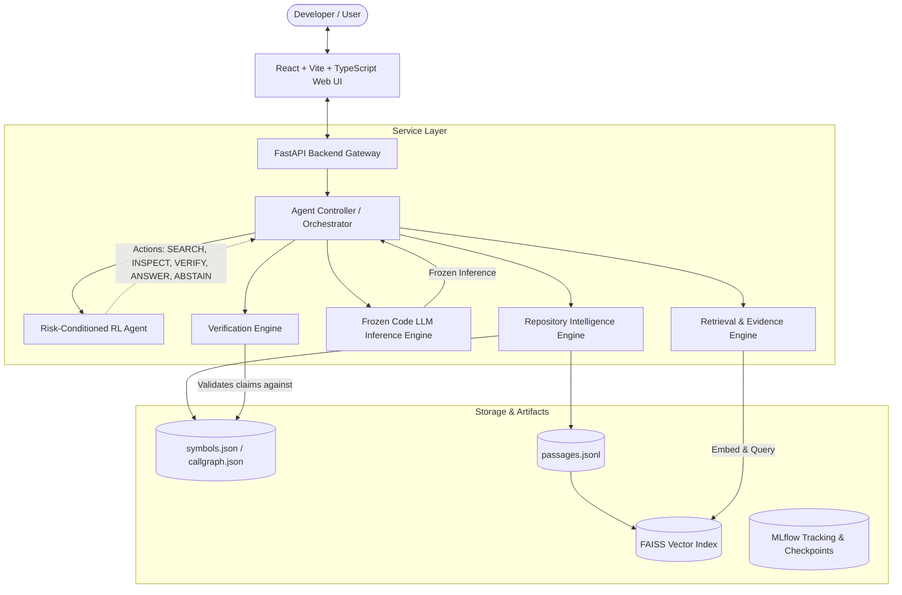
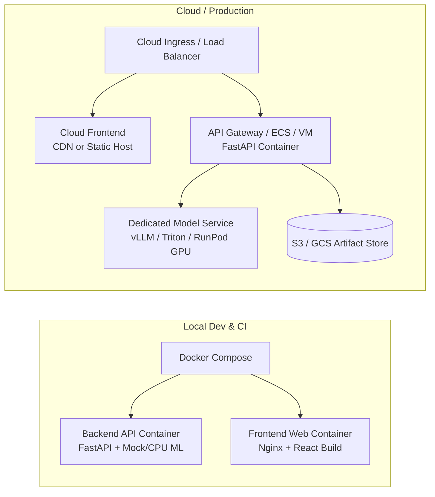

# RepoGuard Architecture Specification

## 1. Executive Summary

**RepoGuard** is a repository-grounded developer assistant designed to combat hallucination and unsupported claims in Large Language Model (LLM) responses to code queries. Rather than allowing an LLM to generate unchecked claims or running open-ended and expensive retrieval loops, RepoGuard introduces:
1. **Repository Intelligence**: Accurate AST parsing, static symbol and call graph extraction, and semantic FAISS indexing.
2. **Structural Verification**: Deterministic fact-checking verifying claimed files, functions, classes, parameters, and invocation relationships directly against ground-truth metadata.
3. **Risk-Conditioned Reinforcement Learning Agent**: A decision-making policy trained to balance answer quality, factual precision, resource/token consumption, and the crucial ability to **abstain** when evidence is missing or unverified.
4. **Frozen Code LLM**: Keeping the language model frozen (e.g., Qwen2.5-Coder 0.5B/1.5B) to ensure the system is lightweight, research-focused, and trainable within student hardware constraints (such as a 6GB VRAM RTX 3050 Laptop GPU).

---

## 2. High-Level System Architecture

---

## 3. Major Modules and Component Responsibilities

### 3.1 Repository Intelligence Engine (`src/repoguard/repository/`)
* **Ownership**: Member 1 (Repository Intelligence Engineer)
* **Components**:
  * `parser.py`: Safe recursive scanning of Python files with `ast`. Extracts:
    * Function definitions, arguments, return types, line spans, docstrings.
    * Class definitions, methods, base classes.
    * Import statements (`import x`, `from x import y`).
    * Path sanitization and directory traversal guards.
  * `callgraph.py`: Resolves intra-repository function calls to construct a directed static call graph with caller-callee edges.
  * `passage_builder.py`: Partitions repository into semantically bounded code passages (functions, classes, module headers) tagged with exact file paths and line ranges.
  * `indexer.py`: Orchestrates parsing, call graph construction, and passage generation. Outputs:
    * `symbols.json`: Full symbol table.
    * `callgraph.json`: Directed invocation graph.
    * `passages.jsonl`: Retrieval passages.

### 3.2 Retrieval & Evidence Engine (`src/repoguard/retrieval/`)
* **Ownership**: Member 1 (with Member 3 interface alignment)
* **Components**:
  * `embedder.py`: Embedding interface (`BaseEmbedder`) supporting `SentenceTransformerEmbedder` (e.g., `all-MiniLM-L6-v2`) and `MockEmbedder` for deterministic CPU/offline testing.
  * `search.py`: Builds and queries FAISS vector indexes (`IndexFlatIP` / `IndexHNSWFlat`). Maps top-K vector matches back to structured `Evidence` objects containing file path, line numbers, snippet content, and similarity scores.

### 3.3 Verification Engine (`src/repoguard/verification/`)
* **Ownership**: Member 2 (Verification and Quality Engineer)
* **Components**:
  * `claim_extractor.py`: Extracts structured factual claims from LLM-generated text or prompts. Claims belong to strict types:
    * `FILE_EXISTS`: Target file exists in repo.
    * `FUNCTION_EXISTS`: Function defined in file.
    * `CLASS_EXISTS`: Class defined in file.
    * `PARAMETER_EXISTS`: Function or method signature contains parameter.
    * `CALLS`: Function A calls Function B.
    * `IMPORTS`: File A imports module/symbol B.
  * `verifier.py`: Evaluates extracted claims against `symbols.json` and `callgraph.json`. Returns per-claim verdicts (`VERIFIED`, `REFUTED`, `UNVERIFIABLE`) and an aggregate `VerificationResult` containing verified ratios and hallucination indicators.
  * **Critical Constraint**: Does *not* claim to evaluate open-ended natural language semantics; strictly evaluates structural code facts.

### 3.4 Frozen Code LLM Inference Engine (`src/repoguard/llm/`)
* **Ownership**: Member 3 (Frozen LLM and RL Engineer)
* **Components**:
  * `prompt_builder.py`: Assembles grounded prompts including system instructions, retrieved code evidence, query constraints, and claim attribution directives.
  * `model_loader.py`: Configurable loader for HuggingFace Transformers (e.g., `Qwen/Qwen2.5-Coder-0.5B-Instruct` or `1.5B-Instruct`), supporting 4-bit/8-bit quantization (`bitsandbytes`) for 6GB VRAM GPUs, and `MockLLM` for fast CPU testing.
  * `inference.py`: Executes deterministic or sampling inference, capturing token usage, response latency, and finish reasons.

### 3.5 Risk-Conditioned RL Agent (`src/repoguard/agent/`)
* **Ownership**: Member 3 (Frozen LLM and RL Engineer)
* **Components**:
  * `actions.py`: Discrete action space:
    * `0: SEARCH`: Issue semantic retrieval query.
    * `1: INSPECT`: Fetch full source of a specific symbol/file.
    * `2: VERIFY`: Extract and fact-check claims against symbol table.
    * `3: ANSWER`: Generate final response with current evidence.
    * `4: ANSWER_WITH_EVIDENCE`: Generate response requiring strict source citations.
    * `5: ABSTAIN`: Refuse to answer due to low evidence, high risk, or failed verification.
  * `state.py`: 18-dimensional continuous state vector representation:
    1. Query token length (normalized).
    2. Query complexity heuristic.
    3. Retrieval passage count (normalized).
    4. Maximum retrieval similarity score.
    5. Mean retrieval similarity score.
    6. Evidence code coverage ratio.
    7. Extracted claim count.
    8. Verified claim ratio.
    9. Refuted claim ratio.
    10. Unverifiable claim ratio.
    11. Model uncertainty / perplexity estimate.
    12. Risk tolerance parameter ($\alpha$).
    13. Current step count (normalized).
    14. Remaining step budget (normalized).
    15. Cumulative token count (normalized).
    16. Flag: Has performed SEARCH.
    17. Flag: Has performed INSPECT.
    18. Flag: Has performed VERIFY.
  * `reward.py`: Multi-objective reward function incorporating:
    * Task accuracy reward (+1.0 for valid verified answers).
    * Hallucination penalty (-2.0 for refuted claims).
    * Action step cost (-0.05 per extra retrieval/inspection step).
    * Token consumption penalty (-0.001 per token).
    * Correct abstention reward (+0.5 when evidence is insufficient or risk is unacceptable).
    * False abstention penalty (-1.0 when reliable answer was possible).
  * `environment.py`: OpenAI Gym / Gymnasium compatible environment (`RepoGuardEnv`) wrapping the repository index, retriever, LLM, and verifier.
  * `policy.py`: PyTorch Deep Q-Network (`DQNNetwork`), Replay Buffer, epsilon-greedy exploration, and a clearly labeled `RuleBasedBaselineController` for benchmark comparison.
  * `controller.py`: High-level orchestrator executing an episode for a user query.

### 3.6 Evaluation & Benchmark Engine (`src/repoguard/evaluation/`)
* **Ownership**: Shared (Led by Member 2 & 3)
* **Components**:
  * `metrics.py`: Computes Recall@K, MRR, Verification Precision, Hallucination Rate, Abstention Accuracy, and Token Efficiency.
  * `evaluator.py`: Batch evaluation driver comparing the trained RL agent against the Rule-Based Baseline and direct Zero-Shot LLM.

### 3.7 API & Presentation Layer (`src/repoguard/api/` & `frontend/`)
* **FastAPI Backend**:
  * `/health`: Health status of all subsystems (LLM, Embedder, Index, Disk).
  * `/repositories`: CRUD and indexing trigger for target repos.
  * `/repositories/{id}/status`: Real-time indexing progress and errors.
  * `/query`: End-to-end question answering returning answer, evidence, verification verdicts, agent action trace, risk metrics, and token/latency breakdown.
* **Vite + React + TypeScript Frontend**:
  * Clean developer dashboard displaying repository status.
  * Interactive query console with adjustable risk-tolerance slider.
  * Visual verification badge breakdown (Verified vs Refuted vs Unverified).
  * Step-by-step Agent Action Timeline.
  * Raw evidence viewer with file paths and line ranges.

---

## 4. Architectural Risks & Mitigation Strategies

| Risk | Description | Mitigation Strategy |
| :--- | :--- | :--- |
| **VRAM & Hardware Limits** | 6GB VRAM (RTX 3050 Laptop) cannot host large models (7B+) along with embeddings simultaneously. | Target Qwen2.5-Coder 0.5B / 1.5B with 4-bit quantization or CPU offload. Maintain `MockLLM` and `MockEmbedder` so CPU-only teammates can develop without friction. |
| **AST Parsing Failures** | Dynamic Python patterns (metaclasses, `getattr`, `eval`, runtime imports) evade static AST. | Gracefully classify unresolved calls as dynamic; verifier explicitly marks dynamic symbols as `UNVERIFIABLE` rather than false negative. |
| **LLM Semantic Drift** | LLM might rephrase a function name slightly (e.g. `calc_sum` vs `calculate_sum`), causing verification refutation. | Use structured prompting requiring exact symbol backticks; implement token-level fuzzy matching fallback in claim extraction. |
| **RL Reward Hacking** | Agent might learn that always executing `ABSTAIN` gives a safe reward (+0.5) and avoids hallucination penalties (-2.0). | Calibrate abstention reward conditionally: penalize abstention when evidence similarity is high ($>0.85$) and verified answer exists. |
| **Security: Path Traversal** | Malicious repo path inputs could allow reading arbitrary host filesystem files. | Enforce strict path resolution checks: ensure canonicalized path lies strictly inside configured `data/repos` root. Untrusted code is parsed as AST data only, never executed! |

---

## 5. Deployment Architecture

### 5.1 Stage 1: Local Dockerized Deployment (Current Boilerplate)
- `backend.Dockerfile`: Python 3.10-slim running Uvicorn + FastAPI with volume mount for `data/`. Starts instantly in CPU/mock mode.
- `frontend.Dockerfile`: Multi-stage build (Node build -> Nginx serving optimized static bundle).
- `docker-compose.yml`: Spins up both containers with health checks, private bridge network, and local storage volume.

### 5.2 Stage 2: Integrated ML Deployment
- GPU passthrough enabled via NVIDIA Container Toolkit (`--gpus all`).
- Embedding model and Qwen2.5-Coder loaded with FP16/INT4 inside container.
- FAISS indexes saved persistently on host volume under `data/indexes/`.

### 5.3 Stage 3: Production Cloud Deployment
- **API**: Stateless container on AWS ECS Fargate, GCP Cloud Run, or Hetzner VPS.
- **Inference**: Decoupled from API. Routes inference requests to dedicated GPU endpoint (e.g. RunPod Serverless or AWS EC2 g4dn.xlarge with T4 GPU) via HTTP/gRPC.
- **Cost Minimization**: Serverless GPU auto-scales to 0 when idle, saving student budget ($0.20/hour active vs $0 idle).

